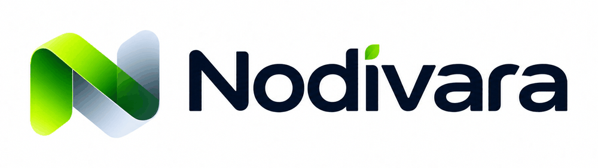
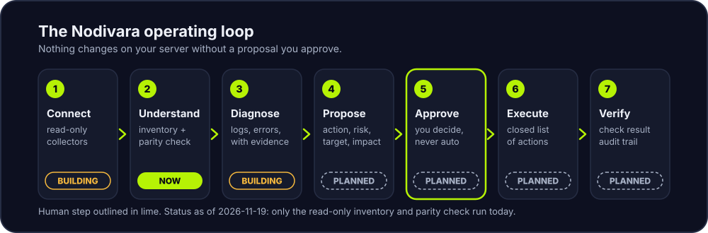

[English](README.md) | Bahasa Indonesia

<div align="center">

<picture>
  <source media="(prefers-color-scheme: dark)" srcset="brand/nodivara-lockup-dark.png">
  
</picture>

### Panel kontrol server dengan agen AI yang mengusulkan, dan **Anda** yang menyetujui.

[](https://github.com/asiifdev/infra-copilot-ai-server-control-panel/actions/workflows/ci.yml)


[Yang sudah berjalan](#yang-sudah-berjalan-hari-ini) · [Cara kerjanya](#cara-kerjanya) · [Dibangun untuk dipercaya](#dibangun-untuk-dipercaya) · [Peta jalan](#peta-jalan) · [FAQ](docs/faq.id.md) · [Perbandingan](docs/comparison.id.md)

</div>

---

**Nodivara adalah panel pengelolaan server open source, untuk pekerjaan yang sama dengan aaPanel dan cPanel, dengan agen AI bawaan yang mengusulkan perubahan dan menunggu persetujuan manusia.** Ditulis dengan Rust dan antarmuka Svelte, menyasar server Linux dan aplikasi desktop, dan masih pra-alfa: belum ada yang bisa dipasang.

Terakhir diperbarui: 2026-11-19.

## Yang sudah berjalan hari ini

> **Status apa adanya.** Belum ada rilis yang bisa dipasang, belum ada agen, dan belum ada panel. Yang ada adalah inventaris hanya-baca dan pemeriksaan kesetaraan yang bisa dijalankan dari kode sumber, ditambah pustaka-pustaka bahan monitor uptime.

| Berjalan sekarang (dari kode sumber) | Sudah berupa pustaka, belum dijalankan | Direncanakan |
|---|---|---|
| Mengumpulkan inventaris Linux secara hanya-baca: port, proses, cron, PM2, systemd, Docker | Pengecekan uptime (HTTP, TCP, kedaluwarsa TLS) dengan perlindungan SSRF | Agen AI dan alur persetujuan |
| Membandingkan dua inventaris dengan **7 aturan kesetaraan**, laporan dalam bahasa Indonesia atau Inggris | Mesin insiden dan alert Telegram | Panel web dan aplikasi desktop |
| Kode keluar 1 bila ada celah kritis, jadi cocok untuk daftar periksa migrasi | Skema database dengan isolasi tenant dan log audit berantai hash | Deploy dari Git, DNS, dan Cloudflare Tunnel |

### Coba sendiri

```sh
git clone https://github.com/asiifdev/infra-copilot-ai-server-control-panel.git
cd infra-copilot-ai-server-control-panel

cargo run -q -p cli -- collect > source.json        # di server lama (hanya-baca)
cargo run -q -p cli -- collect > target.json        # di server baru
cargo run -q -p cli -- compare source.json target.json --lang id
```

Keluaran asli, dari data uji anonim di repositori ini (dipersingkat):

```text
6 temuan dari 7 aturan:

[Kritis] PAR-001: Port 7700 tidak punya padanan di target
  Di sumber, searchd mendengarkan di port 7700 (alamat bind 127.0.0.1). Di target tidak ada yang
  mendengarkan di port itu. Jika searchd tidak ikut pindah, apa pun yang bergantung padanya akan gagal ...
  Saran: Periksa apakah searchd memang harus berjalan di target. Jika ya, pasang dan jalankan di sana ...
  (pendengar tcp:7700)

[Penting] PAR-001: Port 6379 tidak punya padanan di target
  ...

Ini perbandingan hanya-baca dari dua inventaris. Ini tidak membuktikan kedua server setara: hanya
aturan berikut yang diperiksa: PAR-001, PAR-002, PAR-006, PAR-007, PAR-008, PAR-009, PAR-010.
```

Laporannya menyebut apa yang **tidak** diperiksa. Itu disengaja: alat kesetaraan yang mengklaim lebih dari yang ia buktikan lebih buruk daripada tidak ada.

## Cara kerjanya

<p align="center">
  
</p>

*Teks pada diagram berbahasa Inggris. Urutannya: Connect (hubungkan), Understand (pahami), Diagnose (diagnosis), Propose (usulkan), Approve (setujui), Execute (jalankan), Verify (verifikasi). NOW berarti sudah berjalan, BUILDING sedang dibangun, PLANNED direncanakan.*

Agen tidak akan diberi shell. Ia memilih dari **daftar aksi tertutup**, diurutkan dari hanya-baca sampai merusak. Semua yang berada di tingkat 2 ke atas menjadi **Usulan** berisi alasan, target, risiko, dan dampak, lalu menunggu Anda.

| Tingkat | Contoh | Cara berjalan |
|---|---|---|
| 0 Baca | daftar layanan, baca log, kumpulkan inventaris | otomatis; tanpa rahasia |
| 1 Rencana | menyusun rencana migrasi | otomatis; hanya membuat Usulan, tidak mengubah apa pun |
| 2 Ubah ringan | mulai ulang aplikasi non-kritis | Usulan, persetujuan satu klik |
| 3 Ubah berisiko | ganti `.env`, ubah DNS, restore database | Usulan, dry-run, ringkasan dampak, cadangan otomatis; disetujui **hanya di panel** |
| 4 Merusak | hapus data, `DROP`, hapus backup | Usulan, ketik nama target, orang kedua di edisi cloud; **hanya di panel**, tidak pernah otomatis |

*Ini adalah desainnya (lihat [docs/plan.md](docs/plan.md)); tingkat risiko dan penyaring rahasia sudah ada di kode, agen yang memakainya belum.*

## Mengapa Nodivara

| | Artinya | Status |
|---|---|---|
| **AI dengan persetujuan** | Agen menunjukkan alasan, target, risiko, dan dampak. Tidak ada yang berjalan sebelum Anda setuju. | direncanakan |
| **Kesetaraan migrasi** | Bandingkan server lama dan baru lalu temukan yang tertinggal: layanan yang tidak tercatat, `localhost` yang menunjuk mesin yang salah, rekaman DNS yang tak pernah pindah. | **berjalan hari ini** (7 aturan, hanya-baca) |
| **Diagnosis berbukti** | AI harus menyebut log, inventaris, dan proses yang mendasari diagnosisnya, dan mengaku bila bukti kurang. | direncanakan |

Nodivara bukan lomba jumlah fitur. Perbedaannya dengan panel lain, dan apa yang **tidak** kami klaim, ada di [perbandingan](docs/comparison.id.md).

## Dibangun untuk dipercaya

Alat yang bisa mengubah server harus mendapat kepercayaan lewat aturan yang bisa Anda periksa. Ini yang sudah ditegakkan di repositori ini, dengan tautan ke kode atau keputusannya:

| Aturan | Di mana berlaku | Keadaan |
|---|---|---|
| Tanpa shell bebas: hanya daftar perintah hanya-baca yang tetap, tanpa shell, ada batas waktu dan ukuran | [`collectors/exec.rs`](crates/collectors/src/exec.rs), [keputusan 0014](docs/decisions/0014-pelaksana-perintah-terbatas.md) | terimplementasi, teruji |
| Rahasia tidak pernah masuk log, laporan, atau masukan AI | [`core/redact.rs`](crates/core/src/redact.rs); nilai variabel lingkungan hanya diurai di memori lalu dibuang ([0015](docs/decisions/0015-env-ref-dan-versi-layanan.md)) | terimplementasi, teruji |
| Teks dari server adalah data, bukan perintah | alert hanya membawa enum tertutup, tidak pernah teks server ([`monitor`](crates/monitor), [`notifier`](crates/notifier)) | terimplementasi, teruji |
| Monitor tidak bisa dijadikan alat SSRF | pemeriksaan alamat tepat di titik connect, batas redirect dan ukuran ([`net`](crates/net), [0016](docs/decisions/0016-klien-http-tls-monitor.md)) | terimplementasi, teruji |
| Symlink yang ditanam tidak bisa membelokkan pembacaan | penelusuran jalur lewat descriptor direktori, perangkat tidak pernah dibuka ([`rootfs.rs`](crates/collectors/src/rootfs.rs), [0017](docs/decisions/0017-rustix-untuk-rootfs.md)) | terimplementasi, teruji |
| Tenant tidak bisa melihat data satu sama lain; pengubahan data terlihat | kueri berbatas tenant dan log audit berantai hash ([`db`](crates/db)) | terimplementasi, teruji |
| Rantai pasok dipantau di setiap push | `cargo deny`, `cargo audit`, pemindaian rahasia seluruh riwayat, tes Linux dan macOS | di [CI](.github/workflows/ci.yml) |
| Persetujuan manusia untuk apa pun yang mengubah server | alur Usulan | **direncanakan** bersama agen |

Menemukan celah keamanan? Laporkan secara privat: lihat [SECURITY.id.md](SECURITY.id.md).

## Peta jalan

| Tahap | Isi | Status |
|---|---|---|
| M0 Fondasi | tipe domain, i18n, skema database, anggaran ukuran dan kecepatan | selesai |
| M1 Inventaris dan kesetaraan, hanya-baca | kolektor, aturan kesetaraan, CLI, monitor uptime dan alert Telegram | berjalan: kolektor, aturan, dan CLI selesai; pustaka monitor selesai tetapi belum dirangkai |
| M2 Asisten AI hanya-baca | penyedia OpenAI-compatible, chat, memori, alat tingkat 0-1 | direncanakan |
| M3 Perencana migrasi | wizard, backup dan transport, rencana tertulis | direncanakan |
| M4 Eksekusi dengan persetujuan | tingkat 2-4, dry-run, rollback, verifikasi, audit | direncanakan |
| M5 Panel server | situs, versi PHP, database | direncanakan |
| M6 Komersial | lisensi, cloud terkelola, penagihan | direncanakan |
| M7 Rilis terbuka | pembersihan, dokumentasi, pemeriksaan lisensi dan nama final | direncanakan |

## Prinsip

- **Teringan dan tercepat.** Satu biner Rust, UI Svelte 5 yang ditanam di dalamnya, SQLite secara bawaan. Edisi desktop dengan Tauri. Tanpa runtime tambahan di server hanya untuk menjalankan panel.
- **Hak akses minimal.** Daftar aksi tertutup, diurutkan menurut risiko, dengan persetujuan untuk apa pun yang mengubah sesuatu.
- **Rahasia tetap rahasia.** Tidak pernah dicatat di log, ditampilkan, atau dikirim ke model AI.
- **Open core yang jujur.** Intinya open source. Edisi berbayar ditawarkan terpisah; tidak ada bagian inti yang sengaja dilumpuhkan.
- **Inggris dan Indonesia sejak awal.** Semua teks yang tampil ke pengguna lewat katalog terjemahan.

## Jawaban singkat

**Apakah Nodivara siap dipakai?** Belum. Masih pra-alfa. Inventaris hanya-baca dan pemeriksaan kesetaraan bisa dijalankan dari kode sumber; belum ada pemasang, agen, atau panel.

**Apakah AI akan mengubah server saya sendiri?** Menurut desain, tidak: ia mengusulkan, Anda menyetujui, dan tingkat paling berisiko hanya bisa disetujui di panel. Agennya belum ada, jadi saat ini tidak ada yang bisa mengubah server.

**Ditulis dengan apa?** Rust untuk inti dan agen, Svelte 5 untuk antarmuka, SQLite secara bawaan.

Selengkapnya di [FAQ](docs/faq.id.md).

<details>
<summary><b>Struktur repositori</b></summary>

```
crates/core         tipe domain bersama: tingkat risiko, penyaring rahasia (tanpa dependensi luar)
crates/i18n         katalog pesan en/id dengan kunci stabil dan fallback
crates/inventory    model inventaris dan kontrak Collector / ParityRule
crates/collectors   kolektor Linux hanya-baca (port mendengar, proses, cron, PM2, systemd, Docker)
crates/parity       aturan kesetaraan PAR-001, PAR-002, PAR-006, PAR-007, PAR-008, PAR-009, PAR-010, pembanding, dan laporan terlokalisasi
crates/net          klien HTTP/TLS async aman SSRF (pemeriksaan sertifikat) untuk monitor
crates/monitor      mesin insiden uptime (ambang, pemeliharaan, persen uptime), logika murni
crates/notifier     kontrak NotificationChannel, channel kirim Telegram, alert terlokalisasi
crates/watch        perekat: probe lewat net, insiden lewat monitor, alert Telegram lewat notifier (pustaka)
crates/cli          `infra collect` dan `infra compare` (offline, hanya-baca)
crates/db           skema SQLite, kueri berbatas tenant, log audit berantai hash
crates/proto-server prototipe sementara untuk mengukur ukuran biner, memori, dan waktu mulai
ui/                 halaman prototipe Svelte 5 + Vite (ditanam ke biner prototipe)
brand/              berkas logo Nodivara (sudah dioptimalkan); warna dan pemakaian di docs/brand.md
docs/design.md      desain teknis: skema, format inventaris, protokol agen, alur persetujuan
docs/decisions/     catatan keputusan arsitektur
docs/market-research.md   riset pasar dengan fakta dipisah dari inferensi
scripts/            skrip bantu (termasuk measure.sh untuk anggaran kinerja)
.claude/ .agents/   konfigurasi dan skill untuk pengembangan dengan bantuan AI
```

</details>

## Membangun dan menguji

Butuh toolchain Rust stable terbaru.

```sh
cargo test --workspace
cargo clippy --workspace --all-targets -- -D warnings
cargo fmt --all --check
```

## Dokumentasi

- [FAQ](docs/faq.id.md) | [Perbandingan dengan panel lain](docs/comparison.id.md) | [Merek dan warna](docs/brand.md)
- [Desain](docs/design.md) dan [catatan keputusan](docs/decisions/)
- [Berkontribusi](CONTRIBUTING.id.md) | [Kode Etik](CODE_OF_CONDUCT.id.md) | [Kebijakan keamanan](SECURITY.id.md)
- [Lisensi](LICENSING.id.md) | [Pendanaan dan dukungan](FUNDING.id.md) | [Changelog](CHANGELOG.md)

Setiap dokumen punya versi Inggris di sampingnya, kecuali teks lisensi dan changelog (lihat [LICENSING.id.md](LICENSING.id.md)).

## Lisensi

Sementara [AGPL-3.0-only](LICENSE), menunggu keputusan akhir sebelum rilis publik pertama. Lihat [LICENSING.id.md](LICENSING.id.md) untuk artinya dan yang masih terbuka. Nama "Nodivara" ditetapkan pemilik; pemilik melaporkan nama ini masih tersedia dan unik, dan pencarian merek dagang formal belum dilakukan.
