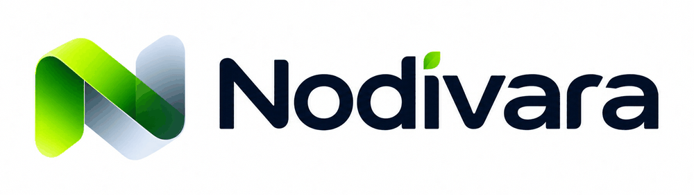
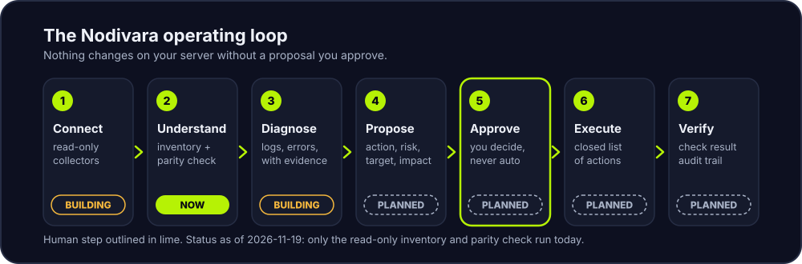

English | [Bahasa Indonesia](README.id.md)

<div align="center">

<picture>
  <source media="(prefers-color-scheme: dark)" srcset="brand/nodivara-lockup-dark.png">
  
</picture>

### Control Your Infrastructure. Trust Every Operation.

**AI proposes. You approve.** Compare two servers before you migrate: it runs today, read-only.

[](https://github.com/asiifdev/infra-copilot-ai-server-control-panel/actions/workflows/ci.yml)


[What works today](#what-works-today) · [Who it is for](#who-is-nodivara-for) · [How it works](#how-it-works) · [Built to be trusted](#built-to-be-trusted) · [Roadmap](#roadmap) · [FAQ](docs/faq.md) · [Compare](docs/comparison.md)

</div>

---

**Nodivara is an open-source server control panel, aimed at the same job as aaPanel and cPanel, with a built-in AI agent that proposes changes and waits for human approval.** It is written in Rust with a Svelte interface, targets Linux servers and a desktop app, and is pre-alpha: nothing is installable yet.

Last updated: 2026-11-24.

## What works today

> **Honest status.** There is no installable release and no server-management panel yet (no sites, PHP versions or databases). What exists is a read-only inventory and a parity check you can run from source, a local command line (`infra`) that stores inventories, keeps migration plan drafts and transport settings, and talks to an AI provider you configure, and a local web UI (`infra serve`) over the same data: it listens on this machine only, for one user, with no TLS and no real login. The uptime monitor is a library that nothing runs yet. No approval or execution path exists: no code can change a server, and the AI assistant has never been run against a live provider (the UI's "Test connection" button and an opt-in test exist, and have only run against a local fake).

| Works now (from source) | Built as libraries, not running yet | Planned |
|---|---|---|
| Collect a Linux inventory, read-only: ports, processes, cron, PM2, systemd, Docker | Uptime checks (HTTP, TCP, TLS expiry) with SSRF protection | The approval workflow for AI proposals |
| Compare two inventories with **7 parity rules** and read the report in English or Indonesian | Incident engine and Telegram alerts | Remote access with TLS and a real login, multi-user; the desktop app |
| Exit code 1 when a critical gap is found, so it fits a migration checklist | Database schema (version 9) with tenant isolation and a hash-chained audit log | Git deploys, DNS and Cloudflare Tunnel |
| Store inventories and comparisons for a node in a local SQLite database (`--save`), and search them | AI assistant turn loop with 14 tools (tier 0 reads, plus tier 1 tools that only write pending proposals, pending memories and draft plans); `infra ask` runs it; OpenAI-compatible client (never run against a live provider) | Approval and execution of proposals and plans (M4) |
| Draft a migration plan from stored inventories and read its gates (`infra plan`); the plan is only a draft | Encrypted secret storage (AES-256-GCM) for provider keys and transport credentials | Running rclone, rsync, scp or ssh for real (the whole run path is covered only by test doubles) |
| Save transport settings, with credentials from stdin only, and preview the commands as a dry run (`infra transport check`) | Organization memory: notes the assistant may propose, active only after a person approves them | An AI model checked against a live provider (Muse, OpenAI, Ollama) |
| Run a **local web UI** (`infra serve`): overview, nodes and their inventory, findings, plans and gates (read-only), transports, assistant chat with streaming answers, memory approval, provider settings, English and Indonesian, light and dark | | Server-panel features: sites, PHP versions, databases (M5) |

### Try it

```sh
git clone https://github.com/asiifdev/infra-copilot-ai-server-control-panel.git
cd infra-copilot-ai-server-control-panel

cargo run -q -p cli -- collect > source.json        # on the old server (read-only)
cargo run -q -p cli -- collect > target.json        # on the new server
cargo run -q -p cli -- compare source.json target.json --lang en
```

Use it as a server migration checklist: run `collect` on the old and the new machine, then `compare`.

### The local web UI

`infra serve` starts a local web server with the UI built from [`web/`](web) (Svelte 5, Vite, TypeScript, no SvelteKit, no runtime dependencies). It needs a database from `infra init`. Build the UI first, so the binary can embed it; without it the server shows a placeholder page.

```sh
./scripts/build-web.sh               # npm ci, type check, tests, production build into web/dist
cargo build -p cli                   # embeds web/dist into the infra binary
target/debug/infra serve             # optional: --port N, --db PATH, --org SLUG (default port 7878, 0 picks a free one)
# prints:  http://127.0.0.1:7878/#t=<one-time token>   open it in a browser

./scripts/demo-serve.sh --fake-ai    # throwaway demo data and a loopback fake AI provider, nothing of yours is touched
./scripts/smoke-serve.sh             # smoke test of the real binary (what CI runs)
```

The printed address signs you in once: the token is valid for 10 minutes, works a single time and sits in the URL fragment, so it is never sent to the server or to another site. The server binds `127.0.0.1` only and refuses any other address. There is no TLS and no password: a session ends after 8 hours of inactivity, on sign-out or when the server restarts, and then you start `infra serve` again. The pages are Overview, Nodes (with inventory), Findings, Assistant, Plans (draft text, steps and gates; there is no approve or run button), Transports, Memory and Settings (provider form with a "Test connection" button, language, theme). Provider keys are only accepted and sealed in the vault; no response ever contains a secret. Checked in Chromium (light and dark, 375 px wide, keyboard); **not** checked on real Windows high contrast or with a real screen reader. The size and speed budget in CI still measures the older prototype page; the real binary with the UI is not measured against a budget yet.

Exit codes of `infra`: 0 success, 1 a critical finding or a blocked cutover, 2 a usage, configuration or I/O error, 3 an assistant or provider failure.

### The local command line

Besides the file-based commands above, `infra` keeps its state in one local SQLite database (`--db PATH`, else `NODIVARA_DB`, else your user data directory). It acts as the owner of a single local organization: there is no login yet. Run a command without arguments for its exact usage text. The examples write `infra` for the binary built from `crates/cli` (or `cargo run -q -p cli --`).

```sh
infra init                                                  # create the local organization and its owner
infra node add --name old-vps --kind vps                    # also: --name new-vps
infra collect --save --node old-vps                         # store an inventory for a node
infra compare --save --source-node old-vps --target-node new-vps
infra plan draft --source old-vps --target new-vps          # a draft only; also: plan list | show NAME | gates NAME
infra transport add --name backup --kind rclone ... --credentials-stdin
infra transport check backup                                # dry run: prints the commands, secrets masked
infra provider add --name muse --base-url URL --model MODEL --key-stdin
infra ask "which ports are open on the new server?"
infra serve                                                 # local web UI on 127.0.0.1, see above
infra memory pending                                        # notes the assistant proposed; also: approve ID | delete ID
```

The first provider you add becomes the organization's default automatically. Environment variables: `NODIVARA_DB` (database path), `NODIVARA_MASTER_KEY` (the key that seals stored secrets, format `<id>:<64 hex>`, for example from `openssl rand -hex 32`), `NODIVARA_PROVIDER_KEY` (the AI provider's API key, an alternative to `--key-stdin`). Keys and credentials are never accepted as command-line arguments. `infra transport check` executes nothing unless you add `--run`, and the product never installs rclone itself. There is no `plan approve` or `plan run`: approval and execution do not exist yet.

Real output, from the anonymous test fixtures in this repository (shortened):

```text
6 finding(s) from 7 rule(s):

[Critical] PAR-001: Port 7700 has no counterpart on the target
  On the source, searchd listens on port 7700 (bind address 127.0.0.1). The target has no listener
  on that port. If searchd did not move, whatever depends on it will fail after cutover; ...
  Advice: Check whether searchd is meant to run on the target. If so, install and start it there ...
  (listener tcp:7700)

[Important] PAR-008: A scheduled job has no counterpart on the target
  The source runs a scheduled job for root (0 3 * * *): backup-db. The target has no matching job. ...

...
This is a read-only comparison of two inventories. It does not prove the servers are equivalent:
only these rules were checked: PAR-001, PAR-002, PAR-006, PAR-007, PAR-008, PAR-009, PAR-010.
```

The report says what it did **not** check. That honesty is deliberate: a parity tool that claims more than it proves is worse than none.

## Who is Nodivara for?

| If you are | The problem | What you get |
|---|---|---|
| **A developer or sysadmin** | One wrong command on a production server costs more than the time an assistant saves. | **Today:** a read-only inventory and a parity check you run from the command line, with the source open to read. **Planned:** an agent that can only pick from a closed list of actions and needs your approval. |
| **An IT architect or infrastructure lead** | You need evidence before a cutover and a record afterwards. | **Today:** a repeatable report that also names what it did not check. **Planned:** approval gates by risk tier and an audit log (the database schema for both already exists). |
| **An agency, software house or business owner** | A client's site breaks after a move because one job or service was forgotten. | **Today:** a server migration checklist you can run: it finds what the VPS migration left behind before you switch the old server off. **Planned:** one panel for many servers, with Telegram alerts. |

## How it works

<p align="center">
  
</p>

The agent will not get a shell. It will pick from a **closed list of actions**, ranked from read-only to destructive. Anything from tier 2 up becomes a **Proposal** with its reason, target, risk and impact, and waits for you.

| Tier | Example | How it runs |
|---|---|---|
| 0 Read | list services, read logs, collect inventory | automatically; no secrets |
| 1 Plan | draft a migration plan | automatically; only creates a Proposal, changes nothing |
| 2 Light change | restart a non-critical app | Proposal, one-click approval |
| 3 Risky change | edit `.env`, change DNS, restore a database | Proposal, dry-run, impact summary, automatic backup; approved **in the panel only** |
| 4 Destructive | delete data, `DROP`, delete backups | Proposal, type the target's name, a second person in the cloud edition; **panel only**, never automatic |

*This is the design (see [docs/plan.md](docs/plan.md)). In code, the registry refuses any tool above tier 1 and the assistant's tools are tier 0 and 1 only; tiers 2-4 and the approval flow are not built (M4).*

## Why Nodivara

| | What it means | Status |
|---|---|---|
| **Approval-gated AI** | The agent shows reason, target, risk and impact. Nothing runs until you approve. | planned |
| **Migration parity** | Compare the old and new server and find what was left behind: a service nobody listed, a `localhost` pointing at the wrong machine, a DNS record that never moved. | **works today** (7 rules, read-only) |
| **Evidence-based diagnosis** | The AI must cite the logs, inventory and processes behind a diagnosis, and say when evidence is missing. | planned |

Nodivara is not a feature-count race. For how it differs from other panels, and what we do **not** claim, read the [comparison](docs/comparison.md).

## Built to be trusted

A tool that can change servers has to earn trust with rules you can check. These are enforced in this repository today, with links to the code or decision:

| Rule | Where it holds | State |
|---|---|---|
| No free shell: only a fixed list of read-only commands, no shell, time and size limits | [`collectors/exec.rs`](crates/collectors/src/exec.rs), [decision 0014](docs/decisions/0014-pelaksana-perintah-terbatas.md) | implemented, tested |
| Secrets never in logs, reports or AI input | [`core/redact.rs`](crates/core/src/redact.rs); environment values are parsed in memory and dropped ([0015](docs/decisions/0015-env-ref-dan-versi-layanan.md)) | implemented, tested |
| Text from servers is data, never instructions | alerts carry closed enums, never server text ([`monitor`](crates/monitor), [`notifier`](crates/notifier)) | implemented, tested |
| The monitor cannot be turned into an SSRF probe | address check at the exact connect call, redirect and size caps ([`net`](crates/net), [0016](docs/decisions/0016-klien-http-tls-monitor.md)) | implemented, tested |
| A planted symlink cannot redirect a read | path walk by directory descriptor, devices never opened ([`rootfs.rs`](crates/collectors/src/rootfs.rs), [0017](docs/decisions/0017-rustix-untuk-rootfs.md)) | implemented, tested |
| Tenants cannot see each other's data; tampering shows | tenant-scoped queries and a hash-chained audit log ([`db`](crates/db)) | implemented, tested |
| Supply chain watched on every push | `cargo deny`, `cargo audit`, full-history secret scan, Linux and macOS tests | in [CI](.github/workflows/ci.yml) |
| The assistant's limits live in code, not in the prompt | tool rounds, calls per round, history and token budget are enforced per turn; one running turn per conversation; user text redacted before it is stored or sent; every tool call audited; a turn needs a current membership ([`agent`](crates/agent), [0023](docs/decisions/0023-putaran-asisten-ai-m2-d.md)) | implemented, tested |
| The AI cannot pass tier 1 | the registry refuses any tool above tier 1; `propose_fix`, `remember` and `draft_migration_plan` can only write a `pending` proposal, a `pending` memory or a `draft` plan; no tool can approve, schedule or run anything | implemented, tested |
| Transport commands carry no secrets in arguments | secrets only in the environment or stdin, a per-backend rclone option allow-list that keeps credential options out of stored specs, no shell ([`transport`](crates/transport), [0025](docs/decisions/0025-transport-dan-konfigurasi-rclone.md)); the runner is never pointed at real hosts in tests | implemented, tested; nothing is executed yet |
| The old server cannot be switched off early | plan ordering and gates in code, plus database triggers on `decommission_source` ([`plan`](crates/plan), [0024](docs/decisions/0024-model-rencana-migrasi-crate-plan.md)) | implemented, tested; no executor yet |
| Notes written by the assistant cannot steer the next turn on their own | a memory the assistant writes starts `pending` (enforced by a database trigger), is never shown to a model or indexed until a person approves it with `infra memory approve`; search queries from a model are quoted so they cannot use FTS5 syntax ([0026](docs/decisions/0026-memori-pencarian-fts5-dan-cli.md)) | implemented, tested |
| Credentials never travel in command arguments | the CLI reads transport credentials and the provider key from stdin or the environment only, seals them with the vault, and `transport check` is a dry run unless `--run` ([0028](docs/decisions/0028-perintah-plan-dan-transport-di-cli.md)) | implemented, tested; nothing has run against a real host |
| The local web server is not reachable from the network or from another website | loopback bind only (other addresses are refused); every request must carry the exact `Host`; changes need a same-origin `Origin` and an `X-Nodivara` header; a one-time sign-in token in the URL fragment, an `HttpOnly` `SameSite=Strict` session cookie; strict security headers including a Content-Security-Policy; no endpoint returns a secret, and provider keys are only accepted and sealed ([`server`](crates/server), [0029](docs/decisions/0029-server-lokal-ui-web-dan-api.md), [0030](docs/decisions/0030-server-lokal-crate-server-dan-bootstrap.md)) | implemented, tested against a real socket; no TLS and no real login, so loopback only |
| Streamed assistant text is redacted like the stored text | text is released only at cuts where the redactor gives the same result as for the whole answer, with a 64 KiB hold cap ([`stream.rs`](crates/server/src/stream.rs)); the core redactor also hides `password = x` with spaces and `Bearer` tokens after extra spaces or a tab | implemented, tested |
| The web UI cannot be turned into a script injector | no `{@html}`, `innerHTML`, `eval` or inline script and style; server, model and tool text goes through one text-only component ([0031](docs/decisions/0031-ui-web-svelte-tanpa-kerangka-tambahan.md)) | implemented, tested (214 tests, axe-core pages in two languages and themes) |
| Human approval for anything that changes a server | proposal flow | **planned** (M4): proposals are only written, never approved or run |

Found a vulnerability? Please report it privately: see [SECURITY.md](SECURITY.md).

## Roadmap

| Stage | What | Status |
|---|---|---|
| M0 Foundation | domain types, i18n, database schema, size and speed budget | done |
| M1 Inventory and parity, read-only | collectors, parity rules, CLI, uptime monitor and Telegram alerts | in progress: collectors, rules and CLI done; monitor libraries done, not wired in |
| M2 Read-only AI assistant | OpenAI-compatible provider, chat, memory, tools of tier 0-1 | mostly done as libraries, a command line and a local web UI (`infra serve`, ADR 0029-0031): tool layer, vault, provider, turn loop, memory, FTS5 search, `infra ask`, chat with streaming answers; remaining: a run against a live provider, a Telegram interface, remote access with TLS, multi-user login |
| M3 Migration planner | wizard, backup and transport, written plan | mostly done as libraries and a command line: plan model (M3-a), transport specs and wizard (M3-b), AI planning tools (M3-c), `infra plan` and `infra transport` (M3-d), plus a read-only view of plans and transports in the web UI; remaining: running transports for real, a command to update transport credentials, an endpoint policy for shared infrastructure (before managed execution), and every approval and execution step (M4) |
| M4 Execution with approval | tiers 2-4, dry-run, rollback, verification, audit | planned |
| M5 Server panel | sites, PHP versions, databases | planned |
| M6 Commercial | licenses, hosted cloud, billing | planned |
| M7 Open release | cleanup, documentation, final license and name check | planned |

## Principles

- **Lightest and fastest.** One Rust binary, a Svelte 5 UI compiled into it, SQLite by default. Desktop edition with Tauri. No extra runtime on your server just to run the panel.
- **Least privilege.** A closed list of actions, ranked by risk, with approval for anything that changes something.
- **Secrets stay secret.** Never logged, never shown, never sent to an AI model.
- **Open core, honestly.** The core is open source. Paid editions will be offered separately; nothing in the open core is crippled on purpose.
- **English and Indonesian from day one.** All user-facing text goes through translation catalogs.

## Quick answers

**Is Nodivara ready to use?** No. It is pre-alpha. The read-only inventory, the parity check, a local command line and a local web UI (this machine only, one user) run from source; there is no installer, no remote access and no server-management panel yet.

**Will the AI change my server by itself?** By design, no: it proposes, you approve, and the riskiest tiers can only be approved in the panel. The assistant exists only as a library, a local command line and a local web UI, and it can only read or write drafts, so today nothing can change a server.

**What is it written in?** Rust for the core and agent, Svelte 5 for the interface, SQLite by default.

More in the [FAQ](docs/faq.md).

<details>
<summary><b>Repository layout</b></summary>

```
crates/core         shared domain types: risk tiers, secret redaction (no external dependencies)
crates/i18n         en/id message catalog with stable keys and fallback
crates/inventory    inventory model and the Collector / ParityRule contracts
crates/collectors   read-only Linux collectors (listeners, processes, cron, PM2, systemd, Docker)
crates/parity       parity rules PAR-001, PAR-002, PAR-006, PAR-007, PAR-008, PAR-009, PAR-010, comparer and localized report
crates/net          SSRF-safe async HTTP/TLS client (certificate inspection) for the monitor
crates/monitor      uptime incident engine (thresholds, maintenance, uptime %), pure logic
crates/notifier     NotificationChannel contract, Telegram send channel, localized alerts
crates/watch        glue: probes via net, incidents via monitor, Telegram alerts via notifier (library)
crates/agent        AI tool layer and assistant turn loop: tool contract, strict argument schemas, tier-gated registry, conversations, 14-tool registry, tier 1 tools write only pending proposals, pending memories and draft plans (library; no approval or execution)
crates/vault        AES-256-GCM sealing of secrets at rest, key rotation (library)
crates/ai           OpenAI-compatible chat client: tool calls, SSE streaming, retries, circuit breaker (library, not yet run against a live provider)
crates/plan         migration plan model: strict spec, step ordering and gates, capacity advice, written plan (pure library)
crates/transport    transport specs, command plans for rclone/rsync/scp/ssh_pipe, runner seam, setup wizard (library; nothing is executed against real hosts)
crates/cli          the `infra` command line: collect, compare, init, node, plan, transport, provider, ask, memory, serve (local single-user mode)
crates/bootstrap    setup helpers shared by the CLI and the server: database location, one local organization, vault from the environment, providers with sealed keys
crates/server       local web server (axum, tokio, rust-embed): JSON API and the embedded web/dist, loopback only, one-time sign-in token, strict headers; started by `infra serve`
crates/db           SQLite schema (version 9, migrations 0001-0009), tenant-scoped queries, FTS5 search, hash-chained audit log
crates/proto-server throwaway prototype used to measure binary size, memory and startup
web/                the web UI: Svelte 5 + Vite + TypeScript, no SvelteKit; built into web/dist and embedded by crates/server
ui/                 Svelte 5 + Vite prototype page (embedded into the prototype binary; still the probe behind the performance budget)
brand/              Nodivara logo files (optimized); colours and usage in docs/brand.md
docs/design.md      technical design: schema, inventory format, agent protocol, approval flow
docs/decisions/     architecture decision records
docs/market-research.md   market research with facts separated from inference
scripts/            helper scripts: build-web.sh, demo-serve.sh, smoke-serve.sh, fake-openai.py, check-secrets.sh, measure.sh (performance budget), check-docs.py
.claude/ .agents/   configuration and skills for AI-assisted development
```

</details>

## Build and test

Requires a recent stable Rust toolchain.

```sh
cargo test --workspace
cargo clippy --workspace --all-targets -- -D warnings
cargo fmt --all --check
./scripts/build-web.sh      # web UI: npm ci, type check, tests, production build (needs Node 24 or newer)
```

Last run: 843 Rust tests pass and 1 is ignored (the live-provider test) in `cargo test --workspace`, plus 214 tests in `web/`. The production bundle is about 131 KB of JavaScript (41 KB gzip) and 15.5 KB of CSS (3.2 KB gzip). Build `web/` before `cargo build -p cli` if you want the UI inside the binary.

## Documentation

- [FAQ](docs/faq.md) | [Comparison with other panels](docs/comparison.md) | [Brand and colours](docs/brand.md)
- [Design](docs/design.md) and [decision records](docs/decisions/)
- [Contributing](CONTRIBUTING.md) | [Code of Conduct](CODE_OF_CONDUCT.md) | [Security policy](SECURITY.md)
- [Licensing](LICENSING.md) | [Funding and support](FUNDING.md) | [Changelog](CHANGELOG.md)

Each document has an Indonesian version next to it (`*.id.md`), except the license text and the changelog (see [LICENSING.md](LICENSING.md)).

## License

Provisionally [AGPL-3.0-only](LICENSE), pending a final decision before the first public release. See [LICENSING.md](LICENSING.md) for what that means and what is still open. The name "Nodivara" is chosen by the owner, who reports it is still available and unique; no formal trademark search has been done yet.
